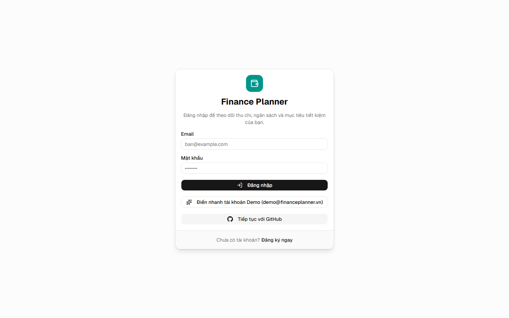
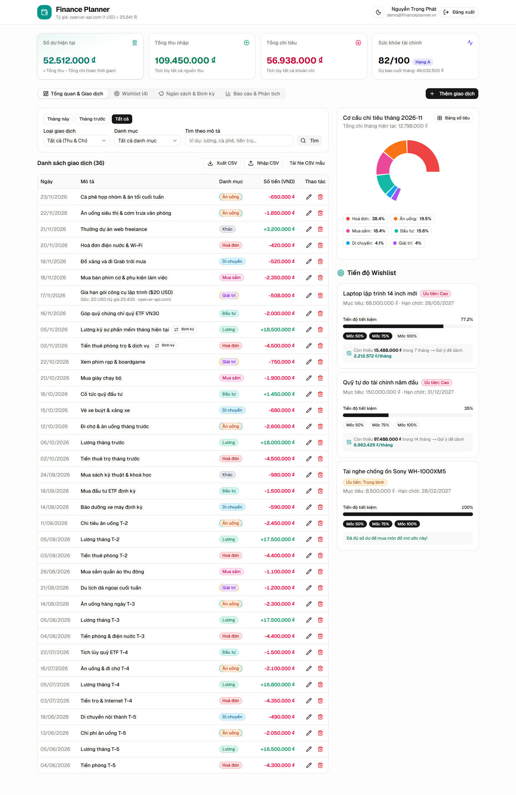
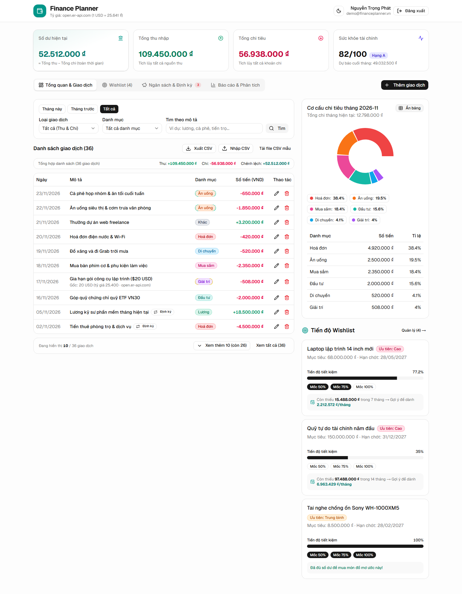
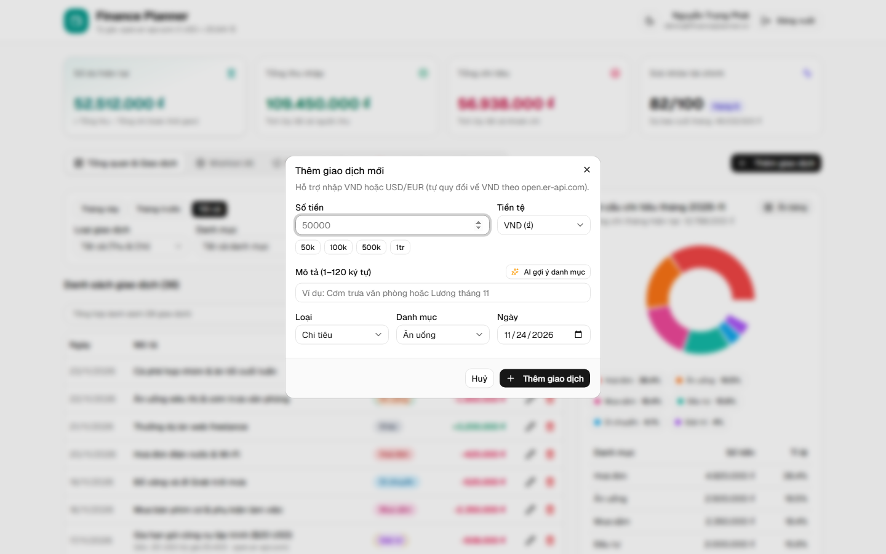
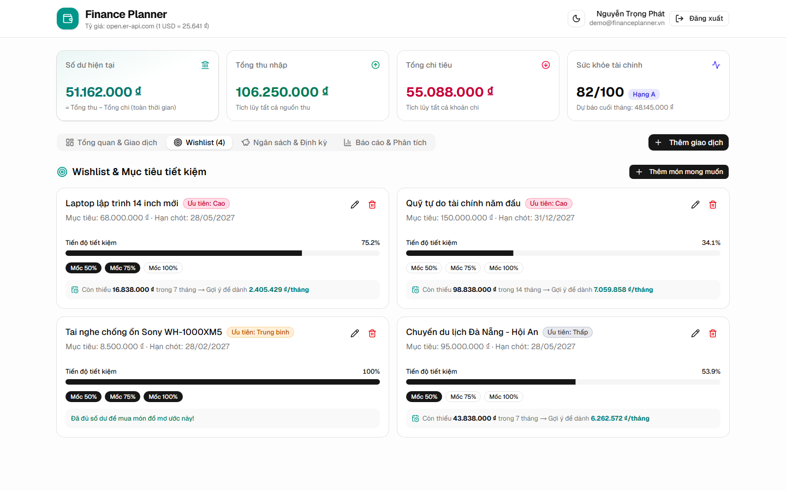
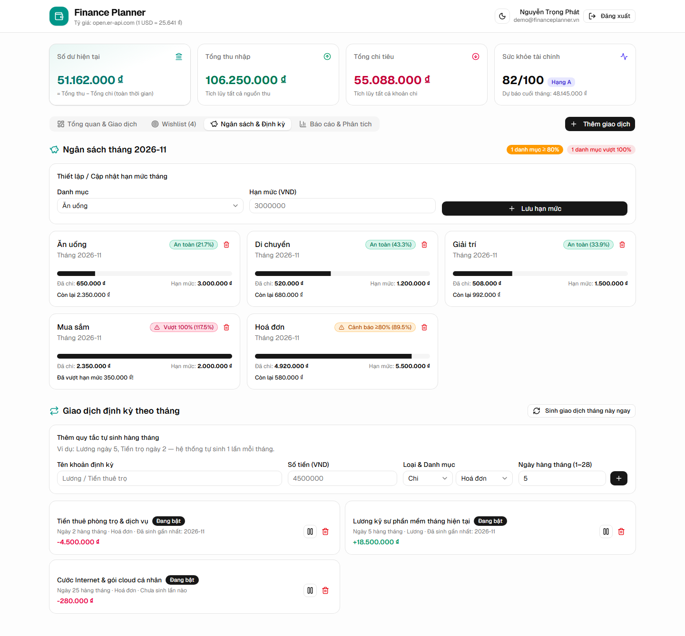
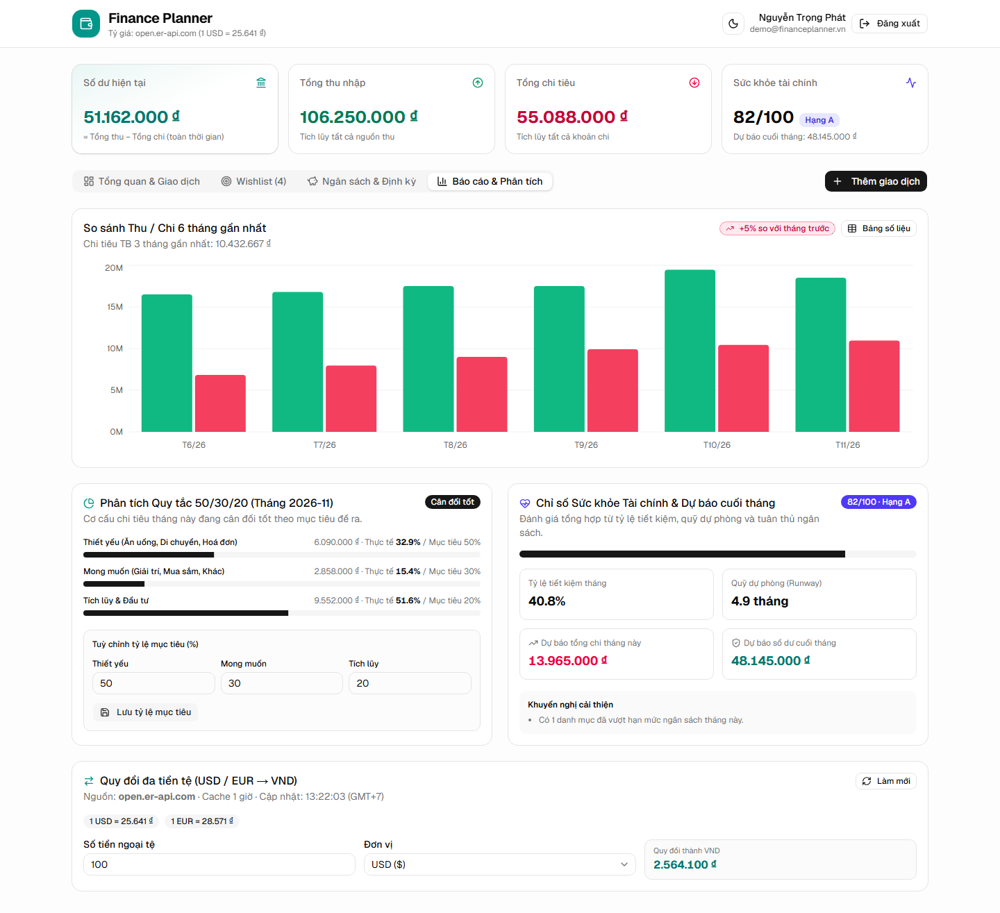
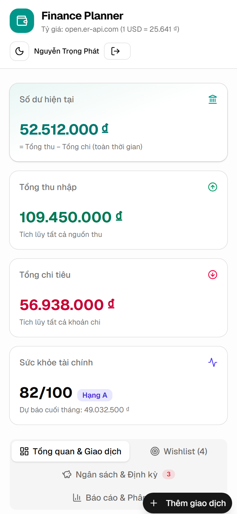

# Finance Planner — Đồ án cá nhân PHY10615 (HK1 2026–2027)

Ứng dụng quản lý tài chính cá nhân: theo dõi thu chi, xem biểu đồ chi tiêu, đặt ngân sách theo danh mục, tạo giao dịch định kỳ, quy đổi đa tiền tệ và theo dõi tiến độ tiết kiệm (Wishlist).

- **Link production (Vercel):** [https://finance-planner-mu-orcin.vercel.app](https://finance-planner-mu-orcin.vercel.app)
- **GitHub Repository:** [https://github.com/phatnguyen196-solverboiz/finance-planner](https://github.com/phatnguyen196-solverboiz/finance-planner)
- **Tài khoản demo:** `demo@financeplanner.vn` / `Demo@123456` (Tên hiển thị: **Nguyễn Trọng Phát** — sinh qua `npx prisma db seed`)

## Ảnh chụp màn hình chính

### 1. Đăng nhập (Email/Mật khẩu + Tài khoản Demo + GitHub OAuth)


### 2. Dashboard Tổng quan, Bộ lọc URL, Giao dịch & Biểu đồ tròn


### 3. Biểu đồ chi tiêu kèm Bảng số liệu thay thế (Accessibility)


### 4. Thêm giao dịch (Đa tiền tệ USD/EUR → VND & AI gợi ý danh mục)


### 5. Wishlist & Mục tiêu tiết kiệm có hạn chót


### 6. Ngân sách theo danh mục (Cảnh báo 80%/100%) & Giao dịch định kỳ


### 7. Báo cáo so sánh 6 tháng, Quy tắc 50/30/20, Sức khỏe tài chính & Quy đổi tiền tệ


### 8. Giao diện Mobile / PWA


## Công nghệ & phiên bản chính

- **Framework:** Next.js `16.4.6` (App Router, `src/proxy.ts`, Cache Components + Suspense), React `19.3.0`, TypeScript `5`
- **Giao diện:** Tailwind CSS v4 (`@theme`, không có `tailwind.config.js`), shadcn/ui (`radix-ui`), `next-themes`, Recharts, Sonner, Lucide Icons
- **Cơ sở dữ liệu & ORM:** PostgreSQL (Neon) + Prisma ORM `7.10.1` (`prisma-client` + `@prisma/adapter-pg` + `prisma.config.ts`)
- **Xác thực & Validation:** Better Auth `1.7.25` (Email/Mật khẩu + GitHub OAuth, `requireUser()` DAL), Zod `4.6.7` (`z.flattenError()`, `z.email()`)
- **AI Exploration (Mức 5):** `@google/genai` (`3.3.0`) gọi phía server cho gợi ý danh mục
- **Kiểm thử & CI:** Vitest `5.1.0`, React Testing Library `16.3.3`, Playwright `1.65.1`, GitHub Actions CI

## Hướng dẫn chạy Local

1. Yêu cầu **Node.js 24** (`node -v`).
2. Cài đặt thư viện:
   ```bash
   npm ci
   ```
3. Tạo file `.env` từ mẫu:
   ```bash
   cp .env.example .env
   ```
   Điền chuỗi kết nối PostgreSQL Neon vào `DATABASE_URL`, chuỗi ngẫu nhiên vào `BETTER_AUTH_SECRET`, và tuỳ chọn `GITHUB_CLIENT_ID`, `GITHUB_CLIENT_SECRET`, `GEMINI_API_KEY`.
4. Chạy migration và seed dữ liệu mẫu (`36` giao dịch, `4` wishlist, `5` ngân sách, `3` quy tắc định kỳ + tài khoản demo):
   ```bash
   npx prisma migrate dev
   npx prisma db seed
   ```
5. Khởi chạy server phát triển:
   ```bash
   npm run dev
   ```

## Chạy kiểm thử

- Unit tests & Component tests (Vitest + React Testing Library):
  ```bash
  npx vitest run
  ```
- Kiểm tra Lint, Typecheck & Build:
  ```bash
  npm run lint
  npm run typecheck
  npm run build
  ```
- Kiểm thử End-to-End (Playwright):
  ```bash
  npx playwright install chromium
  npx playwright test
  ```

## Checklist tính năng theo đề bài

### Tính năng cốt lõi (A.3)
- ✅ Đăng ký / đăng nhập bằng Email + Mật khẩu và GitHub OAuth (Better Auth 1.7), hiển thị tên & nút đăng xuất, phân quyền theo `userId`
- ✅ Quản lý giao dịch CRUD (VND số nguyên dương, mô tả 1–120 ký tự, 2 loại, 8 danh mục, ngày), validate Zod 4 phía server, hiển thị lỗi dưới từng ô & toast Sonner
- ✅ Quản lý Wishlist CRUD (tên, giá VND, ưu tiên Thấp/Trung bình/Cao, thanh tiến độ 0–100%, số dư âm -> 0%)
- ✅ Dashboard & Biểu đồ tròn chi tiêu tháng hiện tại kèm bảng số liệu thay thế cho trình đọc màn hình
- ✅ Lọc & tìm kiếm theo thời gian (`Tháng này` / `Tháng trước` / `Tất cả`), danh mục, loại (Thu/Chi), từ khoá trên URL `searchParams`
- ✅ Thông báo mốc tiết kiệm `50%`, `75%`, `100%` bằng toast chúc mừng không lặp lại, logic thuần có unit test

### Tính năng mở rộng (A.4 + 2 tính năng bổ sung)
- ✅ **#1 Ngân sách theo danh mục mỗi tháng** + cảnh báo ngưỡng `80%` và `100%`
- ✅ **#2 Giao dịch định kỳ** (lương, tiền trọ...) tự sinh theo tháng (idempotent)
- ✅ **#3 Nhập/Xuất CSV** qua Route Handler `/api/transactions/csv` có kiểm tra định dạng từng dòng bằng Zod 4 & chống CSV injection
- ✅ **#4 Đa tiền tệ** quy đổi USD/EUR → VND từ `open.er-api.com`, cache 1 giờ, ghi rõ nguồn và tỷ giá gốc trên giao dịch
- ✅ **#5 Mục tiêu tiết kiệm có hạn chót** (`targetDate` trên Wishlist) và gợi ý số tiền cần để dành mỗi tháng
- ✅ **#6 Báo cáo so sánh các tháng** (biểu đồ cột 6 tháng) và xu hướng chi tiêu kèm bảng dữ liệu a11y
- ✅ **#7 PWA** (`manifest.webmanifest`, icon PNG/SVG, Service Worker `/sw.js`, giao diện tối ưu mobile)
- ✅ **#8 Gợi ý danh mục tự động bằng Gemini API** (key chỉ ở server, xoá PII trước khi gửi, rate-limit theo `userId`, fallback từ khoá khi không có key/lỗi mạng)
- ✅ **#9 (Bổ sung) Phân tích Quy tắc 50/30/20** (Thiết yếu / Mong muốn / Tích lũy) cho phép tuỳ chỉnh tỷ lệ mục tiêu theo từng người dùng
- ✅ **#10 (Bổ sung) Chỉ số Sức khỏe Tài chính & Dự báo cuối tháng** (điểm 0–100, hạng A–D, runway quỹ dự phòng, dự báo số dư cuối tháng)

## Quyết định kỹ thuật & giới hạn đã biết

- **Lưu VND chuẩn số nguyên (`Int`) cho mọi giao dịch:** Khi nhập USD hoặc EUR, hệ thống quy đổi sang VND nguyên theo tỷ giá cache 1 giờ từ `open.er-api.com` và lưu kèm `originalCurrency`, `originalAmount`, `exchangeRate`, `rateSource` để số liệu lịch sử không thay đổi khi tỷ giá biến động.
- **Tách logic thuần sang `src/lib/*`:** Các hàm lọc URL, tính mốc tiết kiệm, ngân sách, CSV, tỷ giá, 50/30/20 và sức khỏe tài chính được tách khỏi Prisma/Next.js để dùng chung giữa Server Component, Route Handler và viết unit test độc lập.
- **Hiển thị danh sách gọn:** Danh sách giao dịch mặc định hiển thị 10 dòng kèm thanh tóm tắt Thu/Chi và nút Xem thêm / Thu gọn; mọi thao tác xoá đều có hộp thoại xác nhận.
- **Cache Components (`cacheComponents: true` trong Next.js 16.4):** Phần đọc session và `searchParams` tại `/`, `/login`, `/register` được đặt trong async Server Component bên trong `<Suspense>` thay vì dùng `export const dynamic = "force-dynamic"`.
- **Giới hạn đã biết:** Cache tỷ giá (`open.er-api.com`) và rate-limit AI lưu trong bộ nhớ tiến trình Node.js (phù hợp quy mô cá nhân; có thể chuyển sang Redis nếu chạy nhiều instance). Khi chưa có `GEMINI_API_KEY` hợp lệ, gợi ý danh mục dùng bộ từ khoá dự phòng.

## Nhật ký sử dụng AI

Xem chi tiết tại [AI_LOG.md](./AI_LOG.md).
